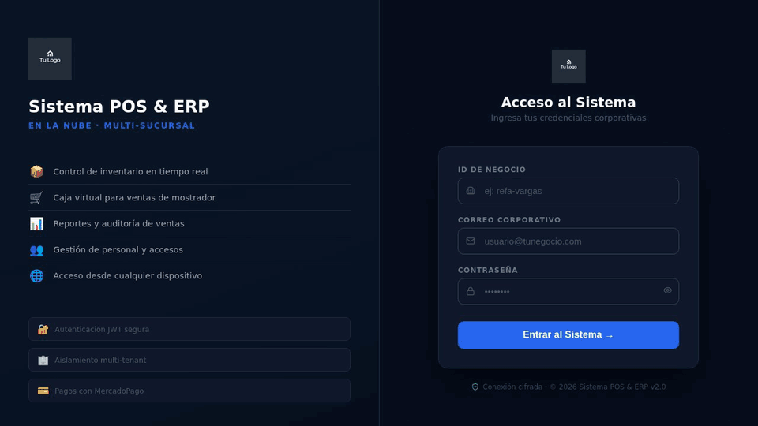
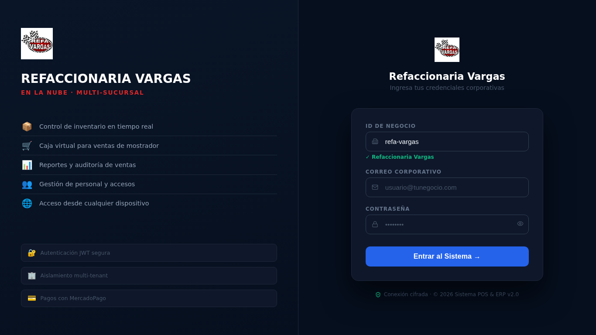
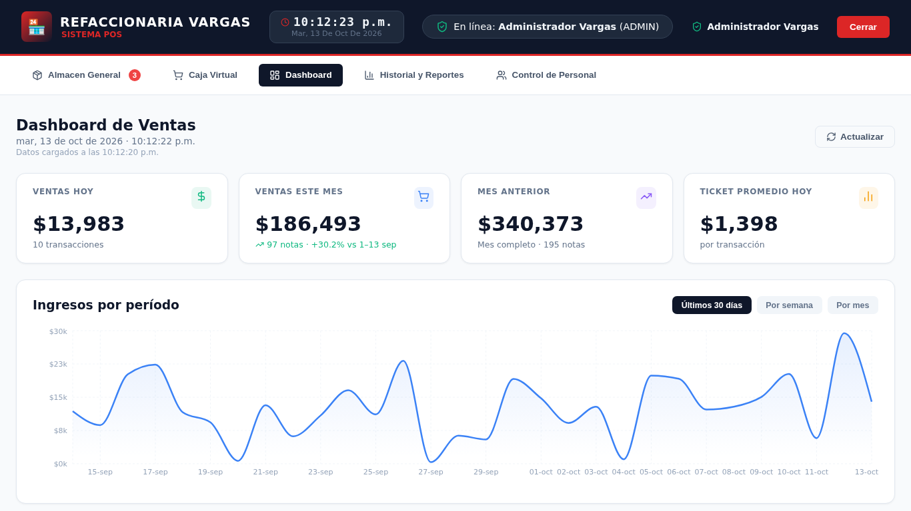
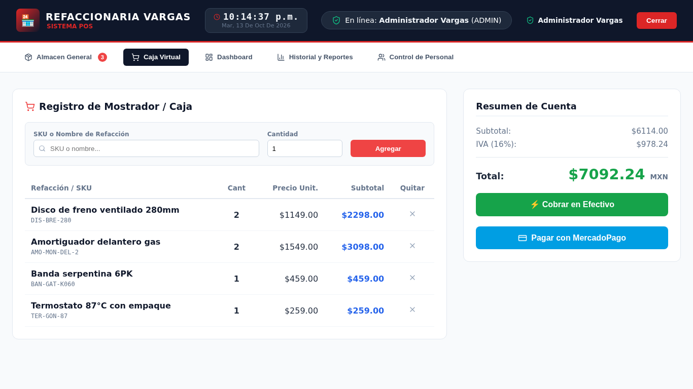
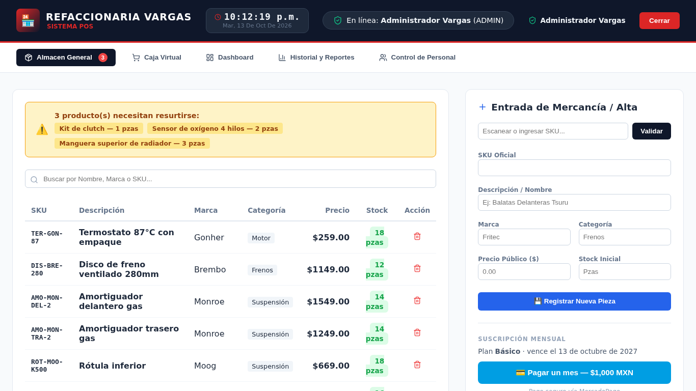
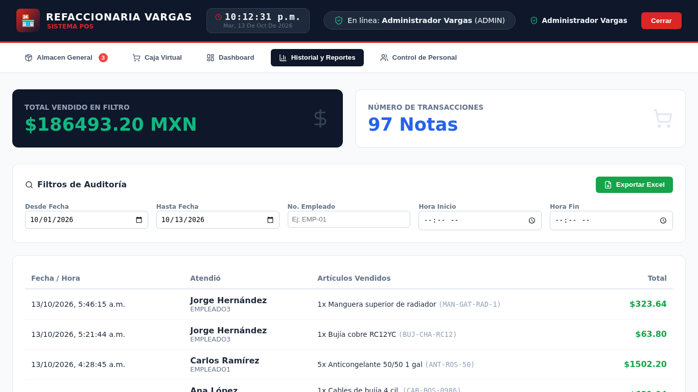
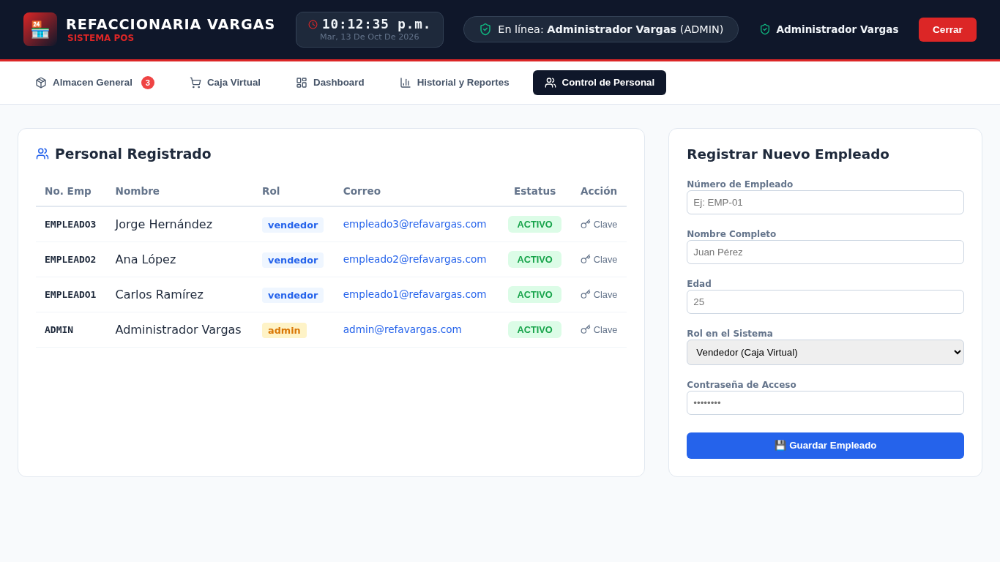
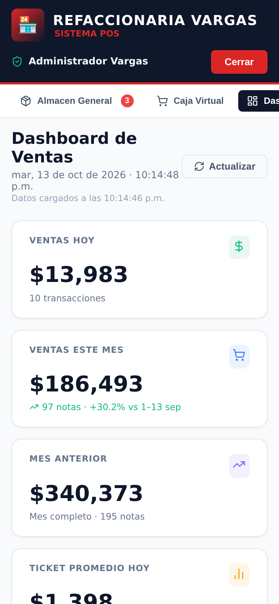
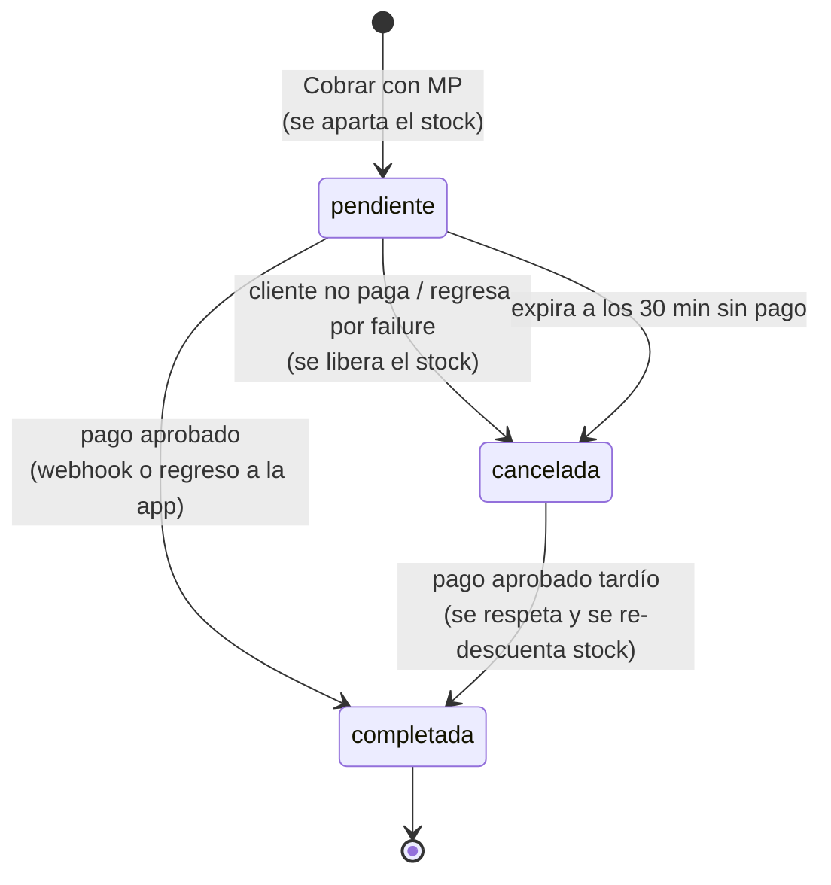

# 🏁 Cloud POS & ERP — Multi-tenant

### Punto de venta e inventario en la nube para refaccionarias y comercios, con pagos y suscripción vía MercadoPago


> **Vitrina del proyecto:** aquí están la demo en vivo, las cuentas de prueba y la documentación técnica. El código fuente vive en un repositorio privado (ver [Código fuente](#-código-fuente)).

> Sistema SaaS que permite a varios negocios operar su inventario, caja y personal desde el navegador, sin servidores locales. Cada negocio (tenant) tiene sus datos aislados, cobra a sus clientes con MercadoPago y paga una renta mensual por usar la plataforma.

---

## 🌐 Demo

**👉 [https://refaccionaria-vargas-demo.netlify.app](https://refaccionaria-vargas-demo.netlify.app)**

<p align="center">
  <br>
  <em>Una venta completa en la demo: login, búsqueda por nombre y SKU, cobro en efectivo y ticket</em>
</p>

Cuentas de prueba (ID de negocio: **`demo`**):

| Rol      | Correo                 | Contraseña         | Qué puede hacer                                       |
| -------- | ---------------------- | ------------------ | ----------------------------------------------------- |
| Admin    | admin@refademo.com     | `AdminDemo2026`    | Todo: dashboard, inventario, reportes, personal, caja |
| Vendedor | empleado1@refademo.com | `VendedorDemo2026` | Caja y consulta del almacén                           |

> 🔄 La demo se reinicia sola **todas las noches** (3:00 a.m., hora de CDMX), así que puedes vender, editar o borrar lo que quieras.
>
> ⏳ El backend corre en el plan gratuito de Render: si nadie lo ha usado en un rato, la primera carga tarda hasta un minuto mientras el servidor despierta.

### Cómo probar la demo (3 minutos)

1. Entra como **Admin**. Al escribir `demo` en "ID de negocio", el login muestra el nombre y el logo de ese negocio.
2. Revisa el **Dashboard**: ventas del día y del mes, crecimiento contra el mes anterior y gráficas por producto, empleado y método de pago.
3. En **Caja Virtual**, busca una refacción por nombre o SKU (por ejemplo `balatas` o `DIS-BRE-280`), agrégala y pulsa **Cobrar en Efectivo**. Se descuenta el stock y aparece el ticket imprimible.
4. En **Historial y Reportes** filtra por fecha o vendedor y exporta a Excel. En **Almacén General** verás las alertas de stock bajo.
5. Cierra sesión y entra como **Vendedor**: solo tiene la caja y la consulta del almacén, y la API rechaza cualquier acción de admin.

El botón **Pagar con MercadoPago** abre un checkout de prueba (sandbox); para completar el pago se necesita una cuenta compradora de prueba de MercadoPago.

---

## 📸 Screenshots

| Login                                      | Dashboard                                    |
| ------------------------------------------ | -------------------------------------------- |
|        |  |
| **Caja virtual**                           | **Almacén general**                          |
|          |      |
| **Historial y reportes**                   | **Control de personal**                      |
|  |    |

<p align="center">
  <br>
  <em>Vista en el celular</em>
</p>

---

## 🚀 Características

### Operación del negocio

- **Inventario en tiempo real** — alta por SKU, stock dinámico y alertas de stock mínimo
- **Caja de mostrador** — carrito con búsqueda por SKU o nombre, ticket de venta imprimible
- **Cobro en efectivo o con MercadoPago** — checkout con tarjeta o saldo de MP
- **Dashboard** — ventas por día, semana y mes; crecimiento contra el mismo avance del mes anterior; top de productos, ventas por empleado y por método de pago
- **Fechas en hora de México** — días, meses y cortes se calculan con el reloj de CDMX, aunque el servidor corra en UTC
- **Historial y auditoría** — filtros por fecha, hora y vendedor, con exportación a Excel
- **Control de personal** — roles Admin / Vendedor, alta, activación y desactivación, y cambio de contraseña

### Plataforma SaaS

- **Multi-tenant** — cada negocio tiene sus propios productos, ventas y empleados, aislados a nivel de API
- **Marca por negocio** — nombre, logo y color primario en el login
- **Suscripción mensual** — 30 días de prueba, renta pagada con MercadoPago, avisos de vencimiento, periodo de gracia y bloqueo automático
- **Panel de superadmin (API)** — alta y baja de negocios, estado de suscripción y registro de rentas pagadas fuera de línea
- **Diseño responsive** — usable desde la computadora del mostrador o desde el celular

---

## 🏗️ Arquitectura

```
                         X-Tenant-ID + JWT
┌──────────────────┐   ───────────────────►   ┌───────────────────┐   Mongoose   ┌─────────────────┐
│  React 19 + Vite │                          │  Node + Express 5 │ ───────────► │  MongoDB Atlas  │
│    (Netlify)     │   ◄───────────────────   │   API REST        │ ◄─────────── │                 │
└────────┬─────────┘          JSON            └─────────┬─────────┘              └─────────────────┘
         │                                         ▲    │
         │ redirige al checkout                    │    │ crea preferencias /
         ▼                                 webhook │    │ consulta pagos
┌──────────────────┐                     (firmado) │    ▼
│   MercadoPago    │ ──────────────────────────────┘
│  Checkout Pro    │
└──────────────────┘
```

**Aislamiento multi-tenant:** cada petición identifica al negocio por el header `X-Tenant-ID`. El middleware de autenticación exige que el `tenantId` firmado dentro del JWT coincida con ese header. Así, un usuario no puede leer datos de otro negocio aunque cambie el header.

---

## 💳 Flujo de pago con MercadoPago

El servidor nunca confía en lo que reporta el navegador. Los precios salen de la base de datos y el estado de cada pago se consulta directamente a la API de MercadoPago.



- **Stock atómico** — el descuento solo procede si hay existencias (`stock >= cantidad`), así que dos cajas no pueden vender la última pieza al mismo tiempo; si un producto del carrito falla, se revierte lo ya descontado
- **Total calculado en el servidor** — precios de la base de datos más IVA 16%; MercadoPago cobra exactamente el total del ticket
- **Validación del pago** — antes de completar la venta se verifica que el monto y la moneda (MXN) coincidan
- **Webhook firmado** — se valida el header `x-signature` (HMAC-SHA256) y las notificaciones repetidas no duplican efectos
- **Solo pagos inmediatos** — en mostrador se excluyen OXXO y depósito en ventanilla

La **renta mensual** usa el mismo mecanismo. Cada pago aprobado suma un mes calendario desde el vencimiento, o desde hoy si ya había vencido, y dos pagos simultáneos no se pisan (concurrencia optimista).

---

## 🛠️ Tech Stack

| Capa          | Tecnología                                                        |
| ------------- | ----------------------------------------------------------------- |
| Frontend      | React 19, Vite 8, React Router 7, Axios, Recharts, Lucide React   |
| Backend       | Node.js 20+, Express 5, JWT, bcryptjs, express-rate-limit         |
| Base de datos | MongoDB Atlas, Mongoose 9                                         |
| Pagos         | SDK oficial de MercadoPago para Node.js (Checkout Pro + webhooks) |
| Reportes      | SheetJS (exportación a Excel)                                     |
| Calidad       | ESLint, Prettier, GitHub Actions (CI en cada push)                |
| Deploy        | Netlify (frontend) · Render (backend) · MongoDB Atlas             |

---

## 🔐 Seguridad

- **Contraseñas** con bcrypt; el hash nunca se incluye en las respuestas de la API
- **JWT ligado al negocio:** un token del negocio A es rechazado (403) en el negocio B
- **Usuarios desactivados** pierden acceso de inmediato, aunque su token siga vigente
- **Rutas de plataforma** protegidas con llave de superadmin, comparada en tiempo constante
- **Sin confianza en el cliente:** precios, totales, vendedor y negocio se toman del servidor y de la sesión
- **Validación de entrada:** login resistente a inyección NoSQL, búsquedas con regex escapada, edición de productos con lista blanca de campos
- **Rate limiting:** 100 peticiones / 15 min en general y 10 intentos / 15 min en el login, por IP real del cliente detrás del proxy; el webhook de MercadoPago y el health check quedan fuera del límite
- **Errores 500 sin detalles internos;** los secretos viven solo en variables de entorno

---

## 📈 Roadmap

- [x] Autenticación con roles (JWT)
- [x] Inventario por SKU con alertas de stock
- [x] Caja virtual, ticket y reportes con exportación a Excel
- [x] Dashboard con gráficas de ventas
- [x] Control de personal
- [x] Arquitectura multi-tenant con aislamiento por negocio
- [x] Cobro de ventas con MercadoPago (webhook firmado, stock apartado, expiración)
- [x] Suscripción mensual con prueba, gracia y bloqueo
- [ ] Reembolsos y contracargos de MercadoPago
- [ ] Cobro recurrente automático de la renta (suscripciones de MP)
- [ ] Pruebas automatizadas en CI
- [ ] Panel web de superadmin
- [ ] PWA instalable (manifest + service worker)
- [ ] Soporte multi-sucursal

---

## 🔒 Código fuente

El código (backend Node/Express, frontend React, modelos, integración con MercadoPago y CI) está en un repositorio privado. Si estás evaluando mi perfil para una vacante o te interesa el sistema para tu negocio, abre un [issue](../../issues) en este repositorio y te doy acceso de lectura.

Puntos que suelo mostrar en una revisión de código:

- Middleware de aislamiento multi-tenant (`X-Tenant-ID` + JWT firmado con el negocio)
- Descuento de stock atómico con rollback y total calculado en el servidor
- Webhook de MercadoPago firmado (HMAC-SHA256) e idempotente
- Suscripción con prueba, gracia y bloqueo 402, con concurrencia optimista

---

## 👨‍💻 Autor

**Rosalio Morales**

- GitHub: [@rosalio-morales](https://github.com/rosalio-morales)
- Stack: MERN · FreeBSD · Cloud Native

> Desarrollado desde Jalisco, México.
